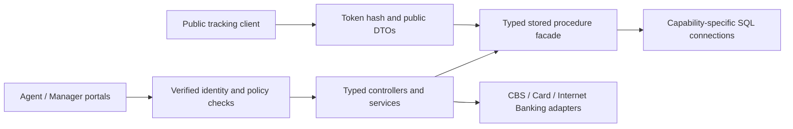

# Architecture

Controllers bind typed DTOs and enforce policies; application services validate requests, coordinate trusted customer lookup and protect tracking delivery. The typed `Procedures` facade maps exact SQL inputs, outputs and ordered result sets to ADO.NET. Only catalogued procedure names are executable. Four internal helpers remain accessible only through their SQL ownership chains, not through an HTTP operation.

The database owns workflow transitions, mandatory approval, immutability, optimistic concurrency and outbox durability. The API adds bounded input validation, trusted actor binding, server-generated cryptographic token hashes, protected delivery envelopes and safe HTTP error translation. Ticket approval invokes no banking transaction.

Database-independent implementations are selected only by explicit flags in Development/Testing. Production adapters without approved documentation fail closed. No Entity Framework, direct table SQL, CBS database connection, React application, database installation or migration is included in Phase 4.

Each operation uses a fresh, non-pooled connection. The six verified actor context keys are set through existing `sys.sp_set_session_context` as read-only; fresh connections prevent pooled session contamination. Commands have cancellation and a 30-second timeout; there is no automatic retry of a mutating SQL call. Procedure-owned transactions/savepoints are preserved; the API does not wrap lease claims inside an ambient transaction.

Result DTOs originate from ScriptDom SELECT projections and table/migration column types; two delegating procedures reuse their actual callee result contract. Result names/count/order are checked even for zero rows; nullable DTO fields reflect the still-unverified runtime nullability. JSON uses camelCase, rowversions are base64 and SQL UTC datetimes are projected as UTC. Request bodies reject unmapped fields.

Structured logs include operation/error codes and server-generated correlation IDs, never credentials, request bodies, token plaintext, delivery envelopes or provider response bodies. Successful supported authentication and middleware start/completion use existing logging procedures. Failed authentication and Auditor authentication SQL-log contracts remain unresolved; see KnownGaps.md.
